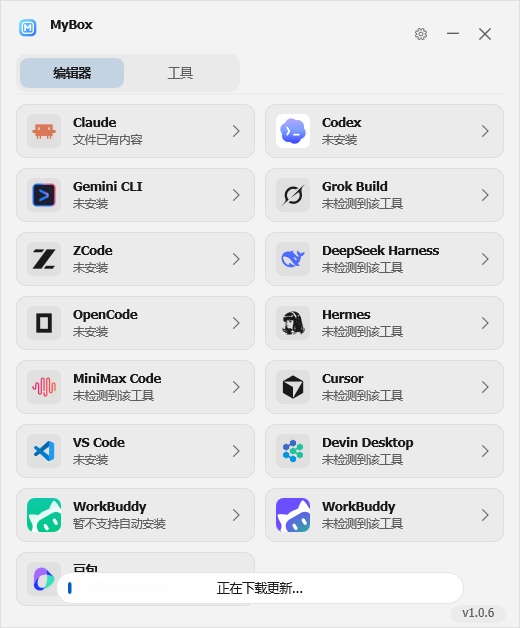
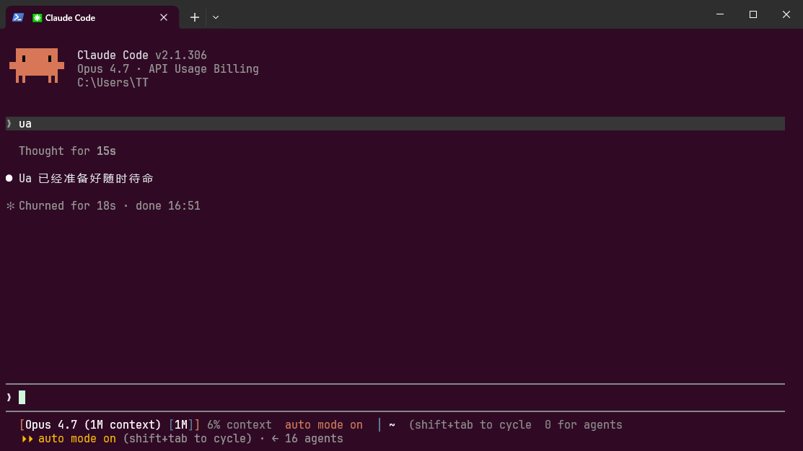

# MyToolbox

[](https://github.com/Aidan-996/MyToolbox/releases)
[](LICENSE)
[](https://github.com/Aidan-996/MyToolbox/actions)

[中文](#mytoolbox-中文) | [English](#mytoolbox-english)

---

## MyToolbox 中文

一键为 AI 编程工具安装提示词和技能的工具。**Windows 图形界面 + Linux 命令行**双版本，
基于 [freyrswift/UaStation](https://github.com/freyrswift/UaStation)（Ua Toolbox）独立维护，
已与上游脱钩：更新与提示词同步只指向本仓库。

> Windows 版程序界面与 exe 名保持上游原名：界面叫「Ua 工具箱」，文件叫 `Ua.exe`。

<p align="center">
  
</p>

### ⚠️ 禁止商用声明

> **本工具完全免费、开源，禁止任何形式的商业使用。**
>
> 严禁对本工具进行出售、倒卖、打包收费、捆绑销售或以任何方式向他人收取费用。
> 如果你是花钱购买的，**你被骗了，请立即要求退款并举报卖家**。
>
> 违反本声明的行为将保留依法追究的权利。

### 法律声明

本工具依据中华人民共和国相关法律法规发布，使用本工具即表示您同意以下条款：

1. **合法用途**：本工具仅用于对用户本人合法拥有或已获书面授权的 AI 编程工具进行本地配置管理。严禁将本工具用于任何违反《中华人民共和国网络安全法》《数据安全法》《个人信息保护法》及其他法律法规的活动。

2. **授权使用**：用户在使用本工具对任何系统、软件或服务进行安全研究时，必须事先取得相关权利人的明确书面授权。未经授权的渗透测试、逆向工程或漏洞利用行为可能违反《中华人民共和国刑法》第二百八十五条、第二百八十六条等相关规定。

3. **免责条款**：本工具按"原样"提供，作者不对因使用本工具产生的任何直接或间接损失承担责任。用户应对自身使用行为及其后果承担全部法律责任。

4. **免费声明**：本工具完全免费且开源。任何以本工具名义收取费用的行为均属欺诈，请立即举报并申请退款。

5. **未成年人保护**：未满 18 周岁的用户应在监护人指导下使用本工具。

### 功能特性

| 特性 | 说明 |
|------|------|
| 🔧 一键安装 | 选择 AI 工具 → 选择提示词 → 点击安装，三步搞定 |
| 🤖 13+ 款 AI 工具 | Claude Code、Codex、Gemini CLI、OpenCode、Cursor、VS Code 等主流工具全覆盖 |
| 🔍 智能检测 | 自动识别电脑中已安装的 AI 工具，未安装的自动灰显 |
| 📝 8 套提示词模板 | 专家模式 / 开发工程 / 写作润色，按需选择 |
| 🧩 40 个内嵌技能 | 逆向 / 漏洞利用 / 内核 / 渗透等方向，随提示词一键装进各工具 |
| 🌐 中英双语 | 界面完整双语（重构后免责声明等界面全部走翻译表） |
| 🎨 深浅主题 | 跟随系统或手动切换，Win11 支持 Mica 效果 |
| 🔄 手动检查更新 | 出于供应链安全考虑，静默自动更新已关闭；菜单"检查更新"手动触发 |
| 🐧 Linux 命令行版 | 同一套提示词/技能数据，`make` 一键编译，CI 端到端测试 |
| 📦 单文件运行 | 1 MB 的 exe，无需安装，无任何依赖 |

### 相比上游的改动

本仓库在上游 v1.0.2 基础上做了一轮完整重构（Windows 版行为不变，只修错误路径）：

- **与上游脱钩**：更新检查、下载、提示词同步地址全部指向本仓库；关闭启动时静默自动更新（改为菜单手动检查）
- **修复真实 bug**：更新包截断下载被误判成功并覆盖真实 exe；更新器忽略写入/启动失败仍退出进程；下载标志线程时序；可点击区域缺手型光标；Skills 滚轮按未过滤数量钳制；颜色格式化溢出隐患
- **国际化补全**：免责声明正文、技能计数、空列表提示等 5 处硬编码中文改走翻译表（英文界面不再出现中文）
- **线程安全**：下载标志改 `std::atomic`；删除跨线程裸指针 toast hack，后台线程不再读任何 UI 状态
- **死代码清理**：未使用的函数/字段/翻译行/VS 向导遗留资源全部移除
- **去重**：矩形命中、按钮位置、toast、字符编码转换等 6 处重复实现各合并为一份（顺带修复非 ANSI 路径下更新批处理的编码隐患）
- **常量收拢**：强调色/面板色收进主题 `Palette`，DWM 裸属性号改具名常量
- **工程修正**：工具集从 v145 重定向到 v143（VS 2022 可直接编译）

### 使用方法（Windows）

1. 从 [Releases](https://github.com/Aidan-996/MyToolbox/releases) 下载 `Ua.exe`（或自行编译，见下文）
2. 双击运行（无需安装、无需管理员权限）
3. 选择 AI 编程工具（如 Claude Code）
4. 选择提示词模板，点"安装"
5. 重启目标 AI 工具，即刻生效

> 💡 卸载：选中已安装的工具，点"卸载"即可恢复原始配置。

#### 验证安装效果

打开目标 AI 工具，输入 `Ua` 后回车，如果回复"**Ua 已经准备好随时待命**"即表示提示词已成功加载：

<p align="center">
  
</p>

之后就可以用大白话向 AI 分配任务，提示词会自动触发对应的技能模板。

### 系统要求（Windows）

- Windows 10 1809+ / Windows 11
- x64 架构

### 构建方法（Windows）

```powershell
msbuild Ua.slnx /p:Configuration=Release /p:Platform=x64
```

需要 Visual Studio 2022+（含 C++ 桌面开发工作负载）。项目已重定向到 v143 工具集，
VS 2022 直接打开 `Ua.slnx` 生成即可；产物在 `x64\Release\Ua.exe`。

### Linux 版

Windows 版的 Linux 命令行对应版本在 [`linux/`](linux/) 目录，与 Windows 版**完全独立**，共用同一套提示词与技能数据文件：

```bash
make -C linux && sudo make -C linux install
```

功能：探测 13 个 AI 编程工具、注入/卸载提示词（自动备份恢复）、Skills 安装/卸载、从 GitHub 同步提示词。详见 [linux/README.md](linux/README.md)，CI 会在 ubuntu 上自动编译并做端到端冒烟测试。

### Star History

[](https://star-history.com/#Aidan-996/MyToolbox&Date)

### 反馈

遇到问题或建议请[提 Issue](https://github.com/Aidan-996/MyToolbox/issues)。

### 许可证与致谢

MIT License，详见 [LICENSE](LICENSE)。基于 [freyrswift/UaStation](https://github.com/freyrswift/UaStation)（MIT）重构与扩展，
内嵌 Skills 与提示词源自其 seep-kit 项目集，图标来自 [lobehub/lobe-icons](https://github.com/lobehub/lobe-icons) 与
[vscode-icons](https://github.com/vscode-icons/vscode-icons)（MIT），一并致谢。

---

## MyToolbox English

One-click prompt and skill installer for AI coding tools. **Windows GUI + Linux CLI**,
independently maintained from [freyrswift/UaStation](https://github.com/freyrswift/UaStation) (Ua Toolbox) —
update checks and prompt sync point only to this repository.

> The Windows app keeps the upstream product name: the UI is "Ua Toolbox", the file is `Ua.exe`.

<p align="center">
  
</p>

### ⚠️ Anti-Commercial Notice

> **This tool is completely free and open source. Commercial use is strictly prohibited.**
>
> It is forbidden to sell, resell, bundle, or charge for this tool in any way.
> If you paid money for it, **you were scammed — demand a refund and report the seller immediately**.
>
> The author reserves the right to pursue legal action against violators.

### Legal Notice

This tool is provided in compliance with applicable laws and regulations. By using this tool, you agree to the following terms:

1. **Lawful Use Only**: This tool is intended solely for managing local configurations of AI coding tools that the user legally owns or has written authorization to access.

2. **Authorization Required**: Users must obtain explicit written authorization before conducting any security research on systems, software, or services. Unauthorized penetration testing, reverse engineering or exploitation may be illegal in your jurisdiction.

3. **Disclaimer**: This tool is provided "as is" without warranty. The author assumes no liability for any damages arising from use. Users bear full legal responsibility for their actions.

4. **Free Software**: This tool is completely free and open source. Any attempt to charge for it is fraudulent.

5. **Minor Protection**: Users under 18 should use this tool under parental guidance.

### Features

| Feature | Description |
|---------|-------------|
| 🔧 One-Click Install | Select tool → Pick prompt → Install. Three steps. |
| 🤖 13+ AI Tools | Claude Code, Codex, Gemini CLI, OpenCode, Cursor, VS Code and more |
| 🔍 Auto Detection | Automatically detects installed AI tools on your system |
| 📝 8 Prompt Templates | Expert / Development / Writing modes |
| 🧩 40 Embedded Skills | Reverse engineering / exploit / kernel / pentest, installed together with prompts |
| 🌐 Bilingual | Fully translated CN/EN interface (disclaimer etc. now use the translation table) |
| 🎨 Themes | Dark / Light / System, Win11 Mica support |
| 🔄 Manual Update Check | Silent auto-update is disabled for supply-chain safety; check via menu |
| 🐧 Linux CLI Edition | Same prompt/skill data, one `make` to build, tested end-to-end in CI |
| 📦 Portable | Single 1 MB exe, no installer, zero dependencies |

### What Changed from Upstream

This repository is a full refactor on top of upstream v1.0.2 (Windows behavior unchanged; only error paths fixed):

- **Decoupled from upstream**: update/download/prompt-sync URLs point to this repo; silent auto-update on launch removed (manual menu check only)
- **Real bug fixes**: truncated update downloads were treated as success and could overwrite the real exe; the updater ignored write/launch failures before quitting; download-flag timing; missing hand cursors on clickable lists; skills wheel clamping; color formatting overflow
- **i18n completion**: 5 hardcoded Chinese strings (disclaimer body, skill counts, empty lists, no-link toast) now go through the translation table
- **Thread safety**: download flag is `std::atomic`; removed the cross-thread toast pointer hack — background threads no longer read UI state
- **Dead code removal**: unused functions/fields/translation rows/VS-template resources
- **Deduplication**: 6 duplicated implementations merged (rect hit-testing, button rects, toast, charset conversion — also fixes a non-ANSI path encoding hazard in the update script)
- **Constant consolidation**: accent/panel colors moved into the theme `Palette`; DWM attribute IDs named
- **Build fix**: toolset retargeted v145 → v143 so VS 2022 builds out of the box

### Usage (Windows)

1. Download `Ua.exe` from [Releases](https://github.com/Aidan-996/MyToolbox/releases) (or build it yourself, see below)
2. Double-click to run (no installer, no admin required)
3. Select an AI tool (e.g. Claude Code)
4. Choose a prompt template and click "Install"
5. Restart the AI tool to apply

> 💡 To uninstall: select the tool and click "Remove" to restore the original config.

#### Verify Installation

Open your AI tool and type `Ua` — if it replies **"Ua is ready and standing by"**, the prompt is loaded correctly:

<p align="center">
  
</p>

### Requirements (Windows)

- Windows 10 1809+ / Windows 11
- x64

### Build (Windows)

```powershell
msbuild Ua.slnx /p:Configuration=Release /p:Platform=x64
```

Requires Visual Studio 2022+ with the C++ Desktop workload. The project is retargeted to the
v143 toolset, so VS 2022 opens `Ua.slnx` and builds directly; output lands in `x64\Release\Ua.exe`.

### Linux Version

A separate Linux CLI edition lives in [`linux/`](linux/). It is fully independent from the Windows GUI, but shares the same prompt and skill data files:

```bash
make -C linux && sudo make -C linux install
```

Features: detect 13 AI coding tools, install/uninstall prompts (with automatic backup & restore), manage skills, sync new prompts from GitHub. See [linux/README.md](linux/README.md). CI builds it on ubuntu and runs end-to-end smoke tests on every push.

### Star History

[](https://star-history.com/#Aidan-996/MyToolbox&Date)

### Feedback

Please [open an issue](https://github.com/Aidan-996/MyToolbox/issues) for bugs and feature requests.

### License & Credits

MIT License, see [LICENSE](LICENSE). Refactored and extended from
[freyrswift/UaStation](https://github.com/freyrswift/UaStation) (MIT). Embedded skills and prompts
come from its seep-kit collection; icons from [lobehub/lobe-icons](https://github.com/lobehub/lobe-icons)
and [vscode-icons](https://github.com/vscode-icons/vscode-icons) (MIT). Many thanks.
